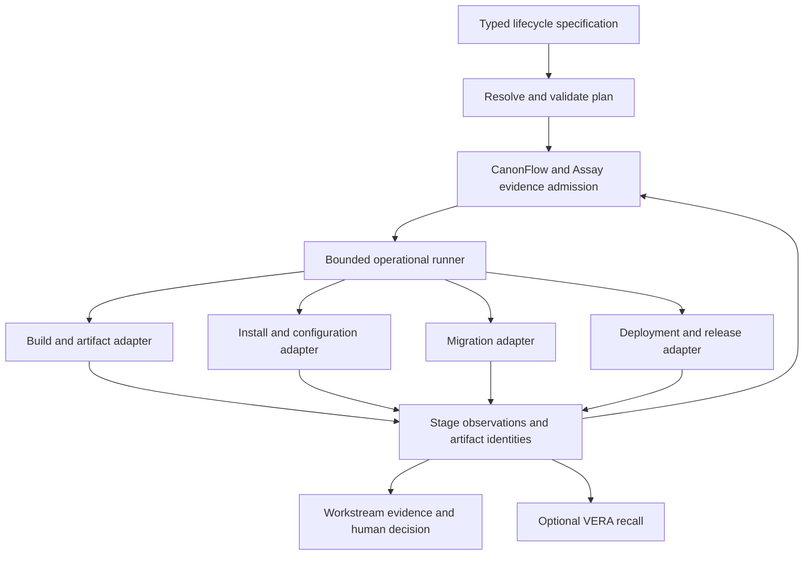

# Hallmark architecture

The platform owns one typed plan and evidence model. The diagram describes the
target architecture. The current Rust implementation covers the
[migration path](#implemented-rust-migration-path).

## Common contract

- A lifecycle has a schema version, a stable identity, a target identity,
  configuration identity, policy identity and identified producer.
- A stage has a stable identity, a kind, an adapter identity, an action/content
  identity, declared input identities and dependency edges.
- Stage kinds include Build, Install, Configure, Migrate, Verify and Release.
  Dependencies express the actual sequencing. Migration is not globally forced
  after installation: a consumer may require pre- or post-deployment migration.
- Desired-state reconciliation, an imperative step and an observation have
  different repetition semantics. One-time work is not automatically converted
  into a convergent operation.
- Dependencies and input identities participate in plan identity. Stage order
  in the submitted document does not alter the identity of the same plan.
- Preview, admission and execution are separate evidence stages. A checkpoint
  requires matching observations through the selected provider.

The archived graph planner limited a plan to 256 stages. Its immutable validation
and checkpoint checks supply behavioral cases for the Rust graph port.

## Adapter boundary

Each adapter must declare its version/content identity, supported operations,
target kinds, preview coverage, required privileges, input/output schema,
resource ownership, cancellation and recovery semantics. It receives explicit
references rather than discovering arbitrary credentials or hosts.

The eventual runner must use literal executable/argument vectors, bounded
output and time, explicit network/filesystem access, and owned process cleanup.
It records invocation identity and observation scope without publishing secret
material. A timeout reports an unconfirmed external outcome until reconciled;
it does not prove a remote effect was cancelled.

Use existing tools as owners of their state: OpenTofu state, Flyway migration
history and Argo-managed objects remain authoritative for their own operations.
The platform records evidence and linkage instead of editing those stores
behind their engines. A platform lease cannot fence an external target unless
the target/adapter actually enforces the fencing token.

## Repository and organization homes

The authenticated account's membership and repository metadata were read on
2026-11-16. A private repository is represented here only as a count; its
contents are not included in this public experiment.

| Organization | Observed repositories | Proposed responsibility |
|---|---:|---|
| CanonFlowFoundation | 11 public, including one archived FSharpAssay repository | Pure assurance contracts, shared documentation/skills, Labs and Incubation; GSTFlow/EDIFlow as candidate consumers |
| CanonFlow-Engineering | 1 public: Workstream | Eventual lifecycle platform and operational adapters, separate from Workstream's existing ledger role |
| CanonFlow-Assay | 17 public | Independently versioned verifier/evidence producers; adapters must preserve each producer's real contract |
| CanonFlow-ONDC | 1 public: Workbench | ONDC-specific profile and lifecycle consumer when implementation exists |
| CanonFlow-VERA | 1 private | Optional versioned evidence recall; memory results do not grant execution authority |

Standalone home: `CanonFlow-Engineering/hallmark`, published at the owner's
request as an experimental local preview. Begin with one repository
and adapter folders; split repositories only when release cadence, ownership or
dependencies justify it. Do not move existing projects merely to match a new
diagram.

M0 originated under `CanonFlowLabs/experiments/hallmark`. CanonFlow core
has no reference to it. Promotion follows Labs → Incubation → a separately
approved consumer/platform release. Kernel promotion additionally needs the
existing real-domain and unchanged-second-consumer evidence.

## Historical M0 guarantees

M0 validates constrained identities, explicit effect/repetition combinations,
graph integrity, deterministic ordering, identified content and resume-claim
compatibility. Its preview cannot establish execution success. It implements
no live locks, authentication, transactional effects or deployment recovery.

Later milestones must qualify each adapter independently, then exercise the
whole consumer flow. Database rollback, application rollback and infrastructure
reconciliation are separate operations with separate preconditions and evidence.

## Implemented Rust migration path

- `rust/src` contains the pure Flyway history comparison, checksum and recovery
  decisions. RustAssay checks that directory.
- `rust/cli/src/plan.rs` reads a versioned manifest and fixes the input, target,
  adapter and producer identities in a plan digest.
- `rust/cli/src/state.rs` stores one plan and operation in a checksummed record.
  Atomic replacement and file and directory sync protect the pending checkpoint
  before dispatch. A state directory lock excludes competing local writers.
- `rust/cli/src/postgres.rs` runs pinned Flyway and reads the PostgreSQL ledger.
  The CLI observes a matching commit before recording success. Resume reads the
  ledger and leaves an unresolved outcome pending.

The [archived preview](QUALIFICATION.md#archived-f-preview) contains the earlier
graph, operations, convergence and signing implementation. The
[command reference](COMMANDS.md) and [roadmap](ROADMAP.md) describe the current
execution contract and its next ports.
