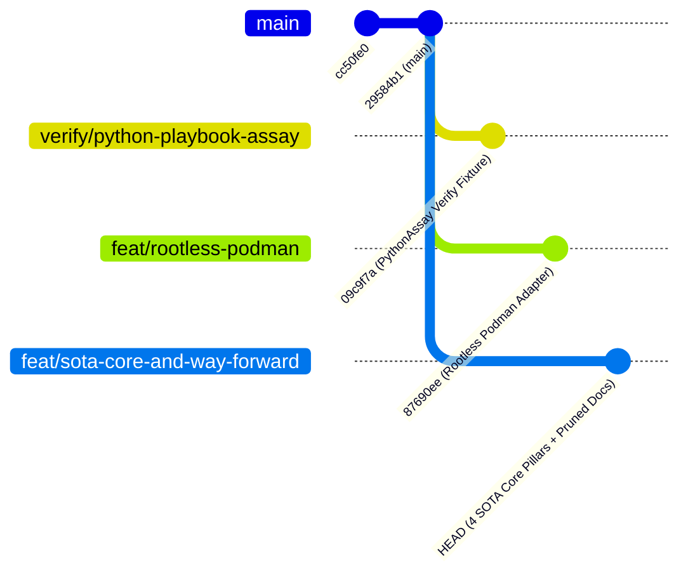

# GPT / Autonomous Agent Execution Playbook for Hallmark v1.0

## 1. Branch Topology & Merge Order on Forgejo

There are currently three branches in `CanonFlow-Engineering/hallmark` descending from `main` (`29584b1`):



| Branch | Head Commit | Files Touched | Conflict Status |
|---|---|---|---|
| `feat/rootless-podman` | `87690ee` | `rust/cli/src/{main,plan,postgres}.rs`, `scripts/verify-wallet-rust.sh`, docs | Touches CLI shell & docs |
| `verify/python-playbook-assay` | `09c9f7a` | `examples/python-playbook/{README.md,verify.sh}`, `QUALIFICATION.md`, `README.md`, `ROADMAP.md` | Minor doc overlap with `87690ee` in `QUALIFICATION.md`/`README.md`/`ROADMAP.md` |
| **`feat/sota-core-and-way-forward`** | **Current Branch** | `rust/src/{lib,history,dag,gates,release}.rs`, `rust/tests/sota_lifecycle.rs`, `docs/sota/*.md` | **Zero file overlap (`0` conflicts) with both `87690ee` and `09c9f7a`!** |

### Recommended Merge Sequence for GPT Reviewer
1. **Merge `feat/rootless-podman` (`87690ee`) into `main`**: Promotes rootless Podman (`ContainerEngine::Podman`, `--timeout 120`, zero host ports) as the default container engine.
2. **Merge `verify/python-playbook-assay` (`09c9f7a`) into `main`**: Resolves the 3-line markdown addition in `README.md`, `ROADMAP.md`, and `QUALIFICATION.md`.
3. **Merge `feat/sota-core-and-way-forward` into `main`**: Clean fast-forward / zero-conflict merge adding `rust/src/{dag,gates,release}.rs`, the upgraded `rust/src/history.rs` (`decide_recovery_v2`, `verify_forward_equivalence`), `rust/tests/sota_lifecycle.rs` (13 total workspace tests, 5 scanned core files), and `docs/sota/*.md`.
4. **Update `.github/workflows/rust-core.yml` RustAssay Pin**: Advance `RUSTASSAY_COMMIT` from `ec2f519a89f7d99a33d4b863d688025bc0527b02` to `274afd1f2a5d970c47252e25f1caf20a6b2c519a` (the `syn` AST + `--check-deps Cargo.toml` release).

---

## 2. Step-by-Step Implementation Prompts for the Next 4 Tasks (`HM-07`, `HM-08`, `HM-15`, `HM-09`)

With `hallmark-core` now containing the pure decision reducers (`dag.rs`, `gates.rs`, `history.rs`, `release.rs`), the remaining work in `docs/delivery/plan-data.ts` reduces to wiring thin CLI shell adapters around these tested core functions.

### Step A — Complete `HM-07`: Wire `hallmark seal` and `hallmark verify-bundle` in `rust/cli/`
* **Core Reducers Already Implemented**: `hallmark_core::gates::evaluate_gates` ([`rust/src/gates.rs`](../../rust/src/gates.rs)) and `hallmark_core::release::verify_release_bundle` ([`rust/src/release.rs`](../../rust/src/release.rs)).
* **Shell Task for GPT**:
  1. Add `rust/cli/src/bundle.rs` (using only `std::fs`, `sha2`, and an explicit Ed25519 or ECDSA P-256 command/crate in `hallmark-cli`—never in `hallmark-core`).
  2. Implement `hallmark seal MANIFEST --state-dir DIR --gates GATES_JSON --signing-key KEY_PATH --out BUNDLE_DIR`:
     * Read `run-v1.json` from `Store` and require `RunResult::Applied`.
     * Parse `GateRequirement` and `GateReceipt` records from `GATES_JSON` and invoke `hallmark_core::gates::evaluate_gates`.
     * Refuse sealing (`ExitCode::from(3)`) unless `evaluation.outcome == AssayVerdict::Pass && evaluation.authoritative`.
     * Write `release-stamp-v1.json`, `gate-receipts.json`, `run-v1.json`, and the SQL/artifact payloads into `BUNDLE_DIR` with atomic `sync_all()`.
  3. Implement `hallmark verify-bundle BUNDLE_DIR --public-key PUB_PATH [--target-policy POLICY_JSON]`:
     * Compute SHA-256 digests of all files in `BUNDLE_DIR`, verify the cryptographic signature over `ReleaseStamp`, and invoke `hallmark_core::release::verify_release_bundle`.
     * Map `AdmittedForTarget` $\rightarrow$ `ExitCode::from(0)`, `HistoricalStampValidButTargetRefused` $\rightarrow$ `ExitCode::from(2)`, `InvalidBundle` $\rightarrow$ `ExitCode::from(3)`.

### Step B — Complete `HM-08`: Wire `READ_LEDGER_V2` & Session-Aware Recovery in `rust/cli/src/postgres.rs`
* **Core Reducer Already Implemented**: `hallmark_core::decide_recovery_v2` and `hallmark_core::verify_forward_equivalence` ([`rust/src/history.rs`](../../rust/src/history.rs)).
* **Shell Task for GPT**:
  1. Replace `READ_LEDGER` in `rust/cli/src/postgres.rs` with `READ_LEDGER_V2` (defined in [`SOTA-FORMAL-PROOFS-AND-CASES.md`](SOTA-FORMAL-PROOFS-AND-CASES.md#production-sql-query-for-read_ledger_v2-drop-in-upgrade-for-rustclisrcpostgresrs)).
  2. Hash `catalogSnapshot` with `sha2::Sha256` to populate `observed_catalog_digest` and parse `activeMigrationSessions` into `active_migration_sessions`.
  3. Call `decide_recovery_v2` in `settle()` so that:
     * An interrupted run where Flyway never started (`active_migration_sessions == 0`, `ExpectedPredecessor`, matching pre-catalog digest) reports `DefinitivelyAbsentRetryEligible`.
     * Out-of-band DDL drift (`DROP INDEX` / `ALTER TABLE` behind Flyway's back) is caught and held with `HoldPostMigrationSchemaDrift`.

### Step C — Complete `HM-15`: Wire Multi-Stage `WorkflowDraft` Execution in `rust/cli/`
* **Core Reducer Already Implemented**: `hallmark_core::dag::validate_workflow` ([`rust/src/dag.rs`](../../rust/src/dag.rs)).
* **Shell Task for GPT**:
  1. Accept a 6-stage `WorkflowDraft` JSON manifest (`hallmark workflow-plan WORKFLOW.json` and `hallmark workflow-apply WORKFLOW.json --plan-digest SHA256 --state-dir DIR`).
  2. Call `validate_workflow(&draft)` to obtain the deterministic topological execution schedule (`ordered_stage_ids`) and verify the **Release Ancestor Coverage Theorem** before executing any stage.
  3. Execute each stage in `ordered_stage_ids` order, persisting write-ahead step state before each `Imperative` or `DesiredState` stage.

### Step D — Complete `HM-09`: Offline Dhall Lowering & Local Stdio MCP Parity
* **Core Reducers Already Implemented**: `validate_workflow`, `evaluate_gates`, `decide_recovery_v2`, `verify_release_bundle`.
* **Shell Task for GPT**:
  1. Add `examples/rust-wallet/workflow.dhall` that normalizes via `dhall-to-json` to the exact `WorkflowDraft` JSON tested in `rust/tests/sota_lifecycle.rs`.
  2. Add a thin `hallmark mcp-stdio` subcommand that reads JSON-RPC 2.0 requests from `stdin` (`hallmark/plan`, `hallmark/validate_workflow`, `hallmark/status`, `hallmark/evaluate_gates`) and calls the exact same `hallmark-core` functions as the CLI, guaranteeing byte-identical plan digests and gate decisions (`CF-020`, `CF-070`).

---

## 3. Mandatory Verification Gate Before Merging Any Step

Every change to `hallmark` must execute the following single-command verification gate and retain its output in an external evidence folder:

```bash
cd /home/arun/Developer/CanonFlow-Engineering/hallmark/rust && \
  cargo fmt --all --check && \
  cargo build --workspace --locked --offline && \
  cargo test --workspace --locked --offline && \
  cargo clippy --workspace --all-targets --locked --offline -- -D warnings && \
  /home/arun/Developer/CanonFlow-Assay/RustAssay/target/debug/rust-assay check src --check-deps Cargo.toml --json
```
