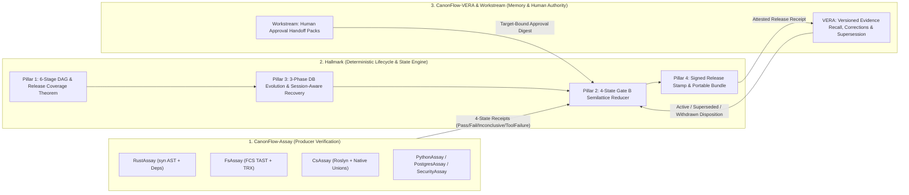

# Hallmark v1.0 — SOTA Architecture & Way Forward

## 1. Strategic Identity: Why Hallmark Is the Building Block of All

Within the CanonFlow ecosystem, software delivery and institutional assurance rest on three strictly orthogonal engines. Confusing their boundaries produces bloat; keeping them orthogonal makes each engine unbeatable:

1. **CanonFlow-Assay (`RustAssay`, `FsAssay`, `CsAssay`, `PythonAssay`, `PostgresAssay`, `SecurityAssay`)** answers:
   * *"Does this source tree, dependency graph, and required test suite satisfy its contract at commit $C$?"*
2. **Hallmark (`hallmark-core` + `hallmark-cli`)** answers:
   * *"Given an observed live target (PostgreSQL cluster/OID + rootless Podman runtime), a frozen dependency and input closure, and a 6-stage lifecycle graph (`Build`, `Install`, `Configure`, `Migrate`, `Verify`, `Release`), how do we execute state transitions with write-ahead crash durability, refuse unverified or drifted states, and seal an offline-verifiable Release Bundle?"*
3. **CanonFlow-VERA (`Vera.Domain`)** answers:
   * *"Across time, which evidence receipts and release stamps remain active, which have been superseded by a correction or security withdrawal, and what is the auditable lineage of every production claim?"*

---

## 2. Diagnosis of the Baseline: What Worked vs. What Was Overengineered

### What Worked Brilliantly
* **Write-Ahead Pending Checkpoint (`rust/cli/src/state.rs`)**: Persisting `run-v1.json` with `File::sync_all()` on both file and parent directory *before* spawning the Flyway container, protected by an exclusive `run.lock` (`0700` state directory), is textbook crash-safe systems engineering.
* **Pure Functional Core (`rust/src/lib.rs`, `rust/src/history.rs`)**: Zero panics, zero `.unwrap()`, zero I/O in `hallmark-core`, verified by `RustAssay` (`RSA-F001` through `RSA-F006`).
* **Rootless Podman Isolation (`feat/rootless-podman`, commit `87690ee`)**: Running PostgreSQL and ephemeral Flyway containers in a shared container network namespace (`--network container:<id>`) with zero published host ports, `--cap-drop ALL`, `no-new-privileges`, and `rootless_graph_root` identity binding.

### What Was Overengineered in `REQUIREMENTS.md` (`CF-001`–`CF-094`)
The 2,146-line `REQUIREMENTS.md` combined a 43-minute spoken brainstorm (`REC-01`–`REC-22`) with 50 competitor profiles (`COMPETITORS.md`), resulting in **94 requirements** that attempt to turn Hallmark into a clone of Nix, Bazel, Terraform, Argo Rollouts, Apple App Store Connect, Backstage, Infracost, Renovate, and Jira Kanban/Gantt simultaneously.
* **See [`OVERENGINEERING-PRUNE-MATRIX.md`](OVERENGINEERING-PRUNE-MATRIX.md)** for the complete 94-requirement pruning table:
  * **16 Core Requirements** are consolidated into **4 mathematical pillars** implemented directly in `hallmark-core`.
  * **54 Provider/Profile Requirements** are deferred to post-v1.0 opt-in adapters.
  * **24 Overengineered Requirements** (mobile app stores, cloud cost estimation, traffic interception, Renovate bots, interactive drag-and-drop Kanban/Gantt portals) are **excised from the engine scope**.

---

## 3. The Four SOTA Pillars Added to `hallmark-core`

On branch `feat/sota-core-and-way-forward`, `hallmark-core` (`rust/src/`) has been expanded from a 2-file migration-only helper into the complete, zero-I/O, `RustAssay`-verified decision kernel for Hallmark v1.0:

### Pillar 1 — Stage-Typed 6-Stage DAG & Release Ancestor Coverage Theorem ([`rust/src/dag.rs`](../../rust/src/dag.rs))
Ports and upgrades the archived F# `Planning.fs` contract into pure Rust:
1. **Six Canonical Stage Kinds**: `Build` (rank 1) $\rightarrow$ `Install | Configure | Migrate` (rank 2) $\rightarrow$ `Verify` (rank 3) $\rightarrow$ `Release` (rank 4).
2. **Effect-Repetition Safety Law (`CF-001`, `CF-038`)**:
   * `EffectKind::Imperative` paired with `Repetition::Reconcile` is rejected (`DagError::UnsafeRepetition`).
   * `StageKind::Verify` with any effect other than `EffectKind::Observation` is rejected (`DagError::VerificationMustObserve`).
3. **Stage-Typed Dependency Outputs (`CF-083`)**:
   * Stages declare typed output keys (`declared_outputs`) and consumed bindings (`consumed_outputs`).
   * Any stage attempting to consume an output from a non-dependency (`OutputProducerNotInDependencies`), an undeclared key (`UndeclaredOutputConsumed`), or a later lifecycle phase (`stage.kind.phase_rank() < producer.kind.phase_rank()`, e.g., `Build` consuming an `Install` endpoint) is rejected (`ForbiddenStageOutputConsumption`).
4. **Deterministic Kahn Topological Sort (`CF-001`)**:
   * Produces the exact same execution order regardless of stage order in the authored manifest, or isolates the exact sorted cycle residual (`DagError::CyclicDependencies`).
5. **Release Ancestor Coverage Theorem (`CF-001`, `CF-078`)**:
   * Every `Release` stage must depend on at least one `Verify` gate (`ReleaseNeedsVerification`), and **every mutating ancestor (`effect != Observation`) of `Release` must be transitively covered by at least one `Verify` gate** (`ReleaseVerificationGap`). No unverified side-migration or configuration step can sneak into a release.

### Pillar 2 — Four-State Assay Gate Semilattice Reducer & VERA Supersession ([`rust/src/gates.rs`](../../rust/src/gates.rs))
Implements `CF-053`, `CF-074`, and `CF-077`:
1. **Gate B Semilattice Precedence**:
   $$\text{ToolFailure} (1) \prec \text{Fail} (2) \prec \text{Inconclusive} (3) \prec \text{Pass} (4)$$
   * A known test or rule violation (`Fail`) is **never** hidden or downgraded to `Inconclusive` when another gate has missing evidence; `outcome` stays `Fail` while `authoritative` becomes `false`, and all reasons are retained.
2. **Exact Five-Tuple Identity Binding**:
   * Every blocking `GateReceipt` must match `(candidate_commit, candidate_tree, producer_id, expected_producer_digest, expected_policy_digest, expected_scope)` and have `scanned_items > 0` (`VacuousZeroScan` protection).
3. **VERA Correction & Withdrawal Resolution (`CF-077`)**:
   * Each receipt carries its resolved `VeraDisposition` (`Active`, `SupersededBy { replacement_digest }`, `Withdrawn { reason }`, `StatusUnknown`). Superseded or withdrawn receipts immediately block release reuse (`EvidenceSuperseded` / `EvidenceWithdrawn`).

### Pillar 3 — Three-Phase Database Evolution: Predecessor Ledger, Catalog Drift, Forward Equivalence & Active-Session Recovery ([`rust/src/history.rs`](../../rust/src/history.rs))
Closes three blind spots in the v0.1 migration pilot (`CF-003`, `CF-004`, `CF-038`, `CF-046`):
1. **Closing the Dead-Code `DefinitivelyAbsent` Branch (`decide_recovery_v2`)**:
   * In v0.1 `cli/src/main.rs`, `History::ExpectedPredecessor` was mapped unconditionally to `LedgerOutcome::Unknown`, leaving `DefinitivelyAbsent` unreachable.
   * `decide_recovery_v2` incorporates `active_migration_sessions: u32` (observed from `pg_stat_activity` / container liveness) and `observed_catalog_digest`:
     * If `ExpectedPredecessor` and `active_migration_sessions > 0` $\rightarrow$ `RecoveryDecisionV2::AwaitInFlightSession` (prevents racing a background container after SIGKILL).
     * If `ExpectedPredecessor` and `active_migration_sessions == 0` and `observed_catalog_digest == expected_pre_catalog_digest` $\rightarrow$ `RecoveryDecisionV2::DefinitivelyAbsentRetryEligible` (provably safe to re-admit).
2. **Out-of-Band Live Schema Drift Detection (`CF-046`)**:
   * Even when `flyway_schema_history` shows the expected CRC32 checksum, if `observed_catalog_digest` differs from `expected_post_catalog_digest` (e.g., an operator dropped an index manually), `decide_recovery_v2` returns `HoldPostMigrationSchemaDrift`.
3. **Fresh-vs-Upgrade Forward Equivalence (`verify_forward_equivalence`, `CF-003`, `CF-004`)**:
   * Compares the `pg_catalog` schema digest of a fresh baseline install against the upgraded fixture schema digest before allowing package publication.

### Pillar 4 — Portable Signed Release Stamp & Destination Admission Verifier ([`rust/src/release.rs`](../../rust/src/release.rs))
Implements `CF-028` and `CF-078` (`HM-07`):
* Separates **Historical Bundle Authenticity** (valid schema, trusted signer key ID, valid cryptographic signature, matching `attested_steps_digest` and `gate_receipts_digest`, exact artifact SHA-256 closure, zero unexpected archive entries) from **Current Destination Target Admission** (matching target identity, current policy digest, and authoritative `Pass` on current VERA-checked gates).
* Returns a three-valued verdict:
  1. `AdmittedForTarget`
  2. `HistoricalStampValidButTargetRefused` (preserves historical audit validity when a receipt is later superseded in VERA or policy rotates!)
  3. `InvalidBundle`
